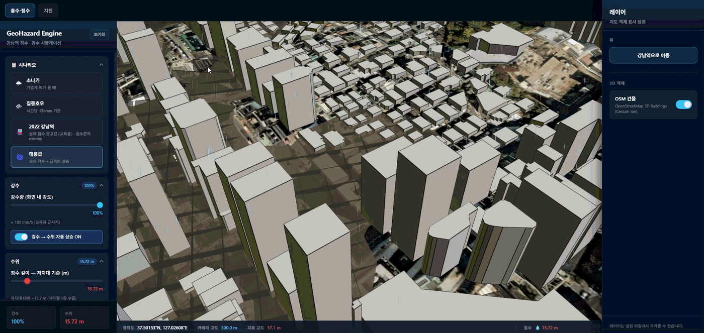
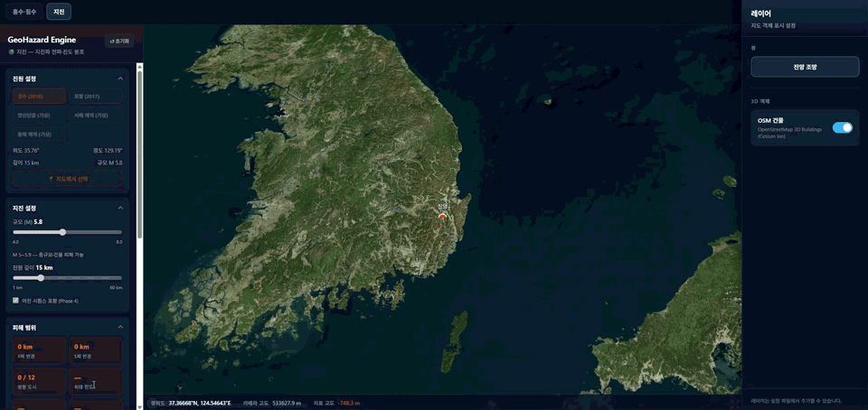

# GeoHazard Engine

[](https://github.com/JSeungHO/geoHazard_engine/actions/workflows/ci.yml)

한국의 실제 재난 사례를 3D 지도 위에서 재현하고 조건을 바꿔 볼 수 있는 **교육용 재난 시뮬레이터**입니다.
Cesium 3D 지형·건물 위에 도시 침수와 지진동 전파를 계산해 보여 줍니다.

**Production**: [geohazard-engine.vercel.app](https://geohazard-engine.vercel.app)

> 교육·체험용 단순화 모델입니다. 실제 재난 예측이나 의사결정에 사용할 수 없습니다. 모델의 근거와 한계는 [docs/model.md](./docs/model.md)에 있습니다.

| 도시 침수 — 2022 강남역 호우 | 지진동 — P/S파 전파와 진도 |
|:---:|:---:|
|  |  |

<sub>스크린샷은 0.2 버전 UI입니다. 0.3 UI로 갱신 예정입니다(`npm run qa:readme`, Cesium 토큰 필요).</sub>

---

## 1. 무엇을 다루나

| 모듈 | 질문 | 대상 지역 |
|------|------|-----------|
| **도시 침수** | 시간당 몇 mm부터 배수가 감당하지 못하고, 얼마나 잠기는가? | 서울 강남역 일대 — 주변보다 10 m 이상 낮은 분지. 2022.8.8 호우로 최대 1.8 m 침수 |
| **지진동** | 지진이 나면 각 도시에 언제, 얼마나 세게 흔들림이 도달하는가? | 한반도 — 2016 경주(ML 5.8), 2017 포항(ML 5.4) 및 가상 시나리오 |

## 2. 접근 방법

**도시 침수**
- 저지대를 하나의 저류조로 보고, 유입 강우(유출계수 × 강우 강도)가 유효 배수능을 넘는 만큼 수위를 올립니다.
- 집수비는 **서울시 침수흔적도 실측 침수심**(강남역 반경 1 km: 0.2~1.8 m)에 맞춰 보정했습니다.
- 계산한 수위를 Cesium 지형 격자에 채워 잠기는 범위를 그리고, 2022 시나리오에서는 실측 침수 구역 폴리곤을 겹쳐 보여 줍니다.

**지진동**
- P파 6.0 km/s, S파 3.5 km/s의 원형 전파로 도시별 도달 시각을 계산합니다.
- 규모·진원 거리로 진도(MMI)를 추정해 도시 표, 지도 진도 레이어, 건물 손상색에 반영합니다. 색상은 USGS ShakeMap 표준을 따릅니다.
- 여진은 본진 이후 같은 타임라인에 이어 재생합니다.

## 3. 모델과 검증

| 구분 | 모델 | 보정·검증 | 신뢰 수준 |
|------|------|-----------|-----------|
| 침수 깊이 | 단일 저류조 강우–배수 모델 | 2022.8.8 강남역 사례 1건으로 보정 (116 mm/h → 1.8 m) | 사례 재현용 |
| 지진파 도달 | 등속 원형 전파 | 지각 평균 속도 | 개략값 |
| 진도(MMI) | 간소화 감쇠식 | 경주·포항 관측 4건 중 1건 일치 | **낮음** |
| 노출 인구·액상화·여진 | 연출용 휴리스틱 | 없음 | 정량 해석 금지 |

진도 모델은 관측 대비 검증 결과를 테스트(`src/physics/validation`)로 고정했습니다.

| 지진 | 지점 | 관측 | 모델 |
|------|------|------|------|
| 2016 경주 | 경주 (11 km) | VI | VI ✅ |
| 2016 경주 | 대구 (54 km) | VI | IV ❌ |
| 2016 경주 | 서울 (282 km) | 유감 (II 이상) | I ❌ |
| 2017 포항 | 포항 (10 km) | VI | VII ⚠️ |

## 4. 한계

- 침수 모델은 사례 1건으로 보정했습니다. 관로 흐름, 역류, 지표 유하 경로는 반영하지 않습니다.
- 진도 모델은 원거리 감쇠가 지나치게 가파르고(약 200 km 밖을 무감으로 계산) 지반 증폭을 반영하지 않습니다. 개선 방향은 [로드맵](./docs/roadmap.md)에 있습니다.
- 관측 자료 일부는 원문 대조 전입니다([model.md §3](./docs/model.md#3-자료-출처)).
- 쓰나미 모듈은 보류 중입니다(코드는 `src/modules/tsunami/`, 탭 미노출).

---

## 시작하기

```bash
npm install
cp .env.example .env    # VITE_CESIUM_TOKEN 입력
npm run dev             # http://localhost:5173
```

지형과 OSM 건물을 불러오려면 [Cesium Ion](https://ion.cesium.com/) 토큰이 필요합니다. Node 20.19 이상 또는 22.12 이상을 사용합니다(`.nvmrc`).

| 명령 | 설명 |
|------|------|
| `npm run dev` / `build` / `preview` | 개발 서버 / 프로덕션 빌드 / 빌드 미리보기 |
| `npm run lint` | ESLint |
| `npm test` | Vitest 단위 테스트 + 모델 검증 |
| `npm run qa:earthquake` | 지진 모듈 Playwright QA (dev 서버 필요) |
| `npm run qa:flood` | 집중호우 시나리오 회귀 검사 (dev 서버 필요) |
| `npm run qa:readme` | README 스크린샷 촬영 (Cesium 토큰 필요) |
| `npm run data:publish-flood-trace` | 침수흔적도 Shapefile → `public/data` GeoJSON ([data/README.md](./data/README.md)) |

QA 스크립트는 headless로 실행되고 스크린샷은 `qa-screenshots/`(git 미추적)에 저장됩니다. 창을 띄우려면 `HEADED=1 SLOWMO=120 npm run qa:earthquake`처럼 실행합니다.

## 기술 스택

React 19 · Vite 8 · [Cesium](https://cesium.com/) / [Resium](https://resium.reearth.io/) · `vite-plugin-cesium` · Vitest · Playwright · lucide-react

## 문서

| 문서 | 내용 |
|------|------|
| [모델](./docs/model.md) | 식, 파라미터 출처, 보정, 검증, 한계 |
| [아키텍처](./docs/architecture.md) | 코드 구조, 데이터 흐름, Cesium 제약 |
| [디자인 가이드](./docs/design.md) | UI 원칙, 디자인 토큰 |
| [로드맵](./docs/roadmap.md) | 남은 작업 |
| [CHANGELOG](./CHANGELOG.md) | 변경 이력 |

## 배포

`main` 브랜치 → Vercel Production, `dev` 브랜치 → Vercel Preview. 환경 변수 `VITE_CESIUM_TOKEN`이 필요합니다.

## 라이선스

[MIT](./LICENSE)
